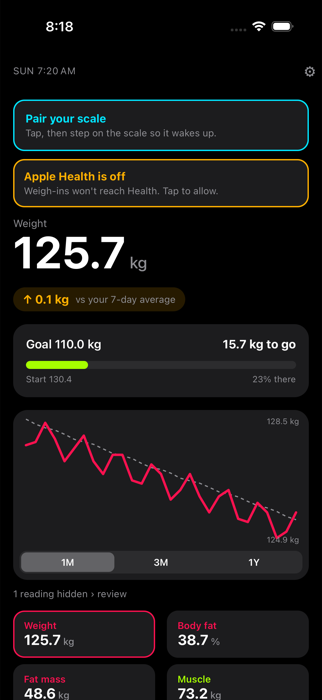
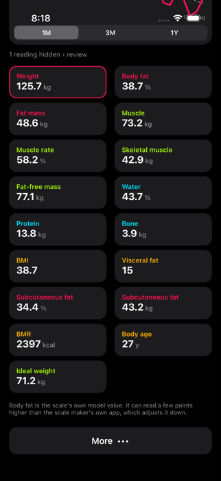
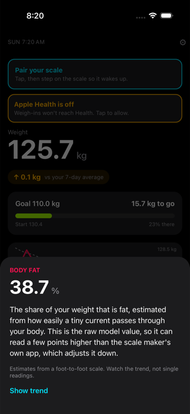
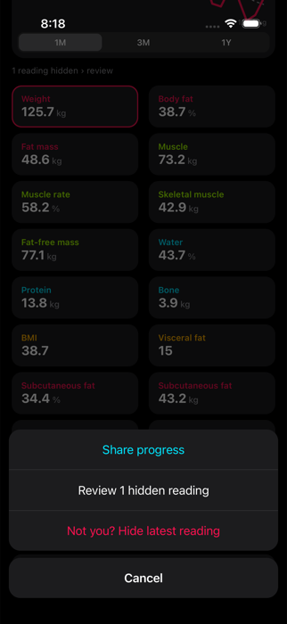
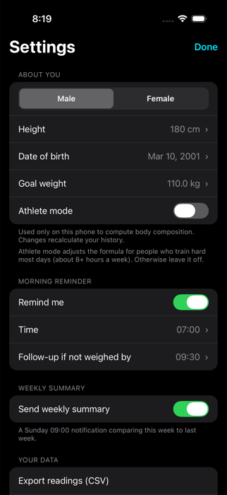
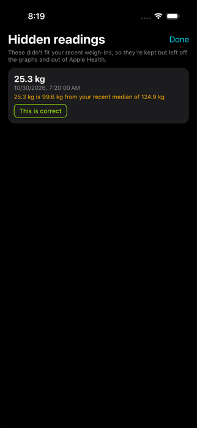
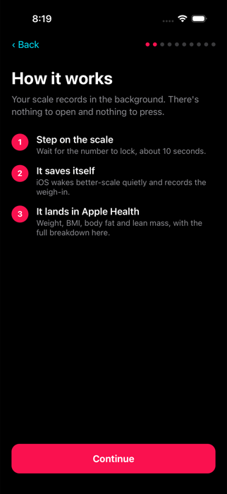
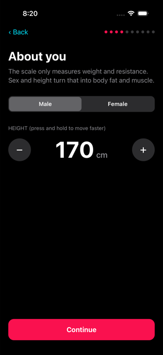

# better-scale

An iPhone app for the Cult Smart Scale (model CS-BF01) and scales built on the same Bluetooth hardware. Step on the scale and your weight and body composition land in the app and in Apple Health. You don't open anything, tap anything, or pair anything again.

Not affiliated with, endorsed by, or derived from the code of Cult.fit or the scale's manufacturer.

<p>
  
  
  
  
</p>
<p>
  
  
  
  
</p>

Screenshots show the simulator demo build with sample data.

## What it does

- **Zero-touch weigh-ins.** The app captures a reading in the background, even after you reboot the phone. iOS wakes it when the scale switches on.
- **Full body composition** computed on the phone: body fat, fat mass, muscle, skeletal muscle, water, protein, bone, visceral fat, BMI, BMR, body age and more.
- **Apple Health sync** (weight, BMI, body fat %, lean body mass), with stable IDs so nothing is ever written twice. If the phone is locked, the reading waits and is written the next time you open the app.
- **Home screen** with a big weight number, change vs your 7-day average, distance to goal, a trend chart (1M, 3M, 1Y) and a tile per metric. Tap any tile and the chart switches to that metric.
- **Outlier detection.** A reading that doesn't fit your recent history (a bag on the scale, a guest) is flagged, kept in the database, hidden from the charts, withheld from Health, and you get a notification. You can review hidden readings.
- **Morning reminder** with a follow-up if you haven't weighed in by a cutoff time.
- **Private.** Everything stays on the phone. No account, no server, no analytics.

## How it works

The scale advertises a Bluetooth LE service `FFF0` and notifies measurements on characteristic `FFF4`. Each measurement is an 11-byte frame: weight in 0.01 kg steps, an encoded impedance value, a status byte (weighing or done), and an XOR checksum. The app holds a pending CoreBluetooth connection with state restoration, so iOS relaunches it in the background when the scale appears. A weigh-in is saved a few seconds after the first valid final frame.

Body composition comes from the weight, the scale's impedance reading, and your sex, height and age. Unadjusted model values are shown.

```
src/
  domain/   pure logic, fully unit-tested: frame parser, body composition, outlier judge,
            reading session, reminder planner, chart series, Health sample planner
  data/     SQLite repository (expo-sqlite)
  native/   Bluetooth (react-native-ble-plx), HealthKit, notifications, log file
  app/      background wiring: capture coordinator, Health flush, reminder refresh
  ui/       screens, onboarding, charts (Skia + Reanimated)
```

## Requirements

- A Mac with Xcode and an iPhone. Bluetooth and HealthKit do not work in Expo Go or the simulator, so this needs a real device build.
- An Apple ID. A free Personal Team works, but the app then expires after 7 days and has to be reinstalled. A paid developer account removes that limit.
- A current Node.js LTS.

## Build and install

```bash
npm install
npx expo prebuild --platform ios
```

Then change the bundle identifier in `app.json` (`ios.bundleIdentifier`) to one of your own, and open `ios/betterscale.xcworkspace` in Xcode.

On a free Personal Team, Xcode can't provision the Push Notifications or HealthKit background-delivery entitlements. Run this after every `prebuild` or `pod install` to strip them:

```bash
bash scripts/fix-entitlements.sh
```

`pod install` needs a UTF-8 locale: `LANG=en_US.UTF-8 LC_ALL=en_US.UTF-8 pod install`.

After prebuild, also run `bash scripts/apply-native-assets.sh` (needs `uv`) to apply the app icon and black splash screen.

Select your phone, set your team under Signing & Capabilities, and run a **Release** build. Release matters: a debug build needs Metro running and will not behave like the background-launched app.

From the command line:

```bash
cd ios
xcodebuild -workspace betterscale.xcworkspace -scheme betterscale -configuration Release \
  -destination 'id=<your-device-id>' -derivedDataPath build -allowProvisioningUpdates \
  DEVELOPMENT_TEAM=<your-team-id> build
xcrun devicectl device install app --device <your-device-id> build/Build/Products/Release-iphoneos/betterscale.app
```

## First run

1. Walk through the setup: sex, height, date of birth, athlete mode, optional goal weight, reminder time.
2. Allow Apple Health and notifications.
3. Tap **Connect scale** and step on the scale so it wakes up.

After that, just weigh yourself. Weigh-ins appear on the home screen after a few seconds.

## Tips and limits

- **Don't swipe the app away in the app switcher.** iOS will not relaunch a force-quit app when the scale appears. Rebooting is fine.
- Health writes need an unlocked phone. A reading taken while locked is stored immediately and written to Health when you next open the app.
- Athlete mode is for people who train hard most days (about 8+ hours a week). It changes the formula, so leave it off otherwise.
- Changing your profile recalculates all stored readings.
- Tested on one scale model and one iPhone. Other scales from the same vendor may or may not work; the 8-electrode "Pro" models use a different model and are unsupported.

## Development

```bash
npm test          # Jest: frame parser, body composition golden vectors, outliers, sessions, DB, reminders
npx tsc --noEmit  # type check
```

The app writes a rolling log to `Documents/app-log.txt`. Pull it from a connected phone:

```bash
xcrun devicectl device copy from --device <your-device-id> --domain-type appDataContainer \
  --domain-identifier <your-bundle-id> --source Documents/app-log.txt --destination ./app-log.txt
```

`ACCEPTANCE.md` is the on-device test checklist (background, locked phone, reboot, outliers, force quit, reminders, Health denied).

## Notice

The body-composition formulas in `src/domain/bodycomp.ts` were reimplemented by analysing how the scale vendor's own app computes them, and the test vectors in `__tests__/golden` were generated from that implementation. That is a personal-use shortcut. Before this is distributed beyond personal use or put in an app store, the algorithm should be replaced with a clean-room implementation or licensed from the vendor. Do not reuse the vendor's name, logos or assets in a release.

## License

No license has been chosen yet. Until one is added, all rights are reserved. (The `LICENSE` file currently in this repo came with the Expo project template and is Expo's, not this project's.)
